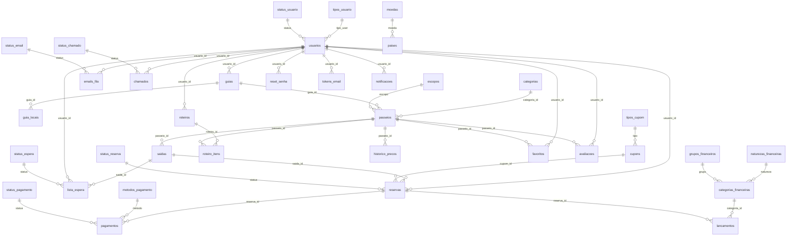

# Documentação do banco de dados — Roteira

Banco `portal_viagens` (MySQL 8 / MariaDB 10.4+, utf8mb4). Criação e dados de exemplo: `database/portal_viagens.sql`.

## Convenções e decisões de projeto

- **Sem ENUM.** Todo conjunto fixo de valores virou uma *tabela de domínio* (`status_reserva`, `status_pagamento`, `metodos_pagamento`, `status_espera`, `status_usuario`, `tipos_usuario`, `escopos`, `naturezas_financeiras`, `grupos_financeiros`); a coluna que usa o valor é `VARCHAR` com chave estrangeira. Vantagens: novos valores sem `ALTER TABLE`, integridade garantida, nome amigável e ordem de exibição.
- **Dinheiro** sempre em `DECIMAL` (nunca `FLOAT`). Valor e taxa ficam gravados na reserva: mudar o preço depois não altera reservas antigas.
- **Regras no banco:** `CHECK` em `avaliacoes.nota` (1–5) e `lancamentos.valor` (> 0); `UNIQUE` para uma avaliação por usuário/viagem; chave composta em `favoritos`.
- **Senhas** com `password_hash` (bcrypt). Tokens de recuperação guardam só o hash SHA-256.
- **Vagas:** `saidas.vagas_disponiveis` é alterada em transações com `SELECT ... FOR UPDATE` (evita vender a mesma vaga duas vezes).
- **Fuso:** a conexão fixa `-03:00`; prazos de pagamento usam o `NOW()` do banco.

## Diagrama entidade-relacionamento (Mermaid)

## Dicionário de dados

### Tabelas de domínio

| Tabela | Valores (código) | Uso |
|---|---|---|
| `tipos_usuario` | 1, 2, 3, 4, 5, 6 | Perfis de acesso (Viajante, Guia local, Administrador). |
| `status_usuario` | ativo, inativo, bloqueado | Situação da conta. |
| `escopos` | nacional, internacional | Alcance da viagem. |
| `status_reserva` | aguardando_pagamento, em_analise, confirmada, cancelada, expirada | Ciclo de vida da reserva. |
| `status_pagamento` | informado, confirmado, recusado | Situação do pagamento informado. |
| `metodos_pagamento` | pix, transferencia | Formas de pagamento aceitas. |
| `status_chamado` | aberto, respondido, fechado | Situação do chamado (aberto, respondido, fechado). |
| `status_email` | pendente, enviado, falhou | Situação do e-mail (pendente, enviado, falhou). |
| `tipos_cupom` | percentual, valor | Tipo de cupom (percentual ou valor fixo). |
| `status_espera` | aguardando, notificado, cancelado | Situação na lista de espera. |
| `naturezas_financeiras` | receita, despesa | Receita (ganho) ou despesa (perda). |
| `grupos_financeiros` | receita, deducao, custo_direto, operacional | Grupos do demonstrativo financeiro. |

### `usuarios`

Contas de viajantes, guias e administradores, com preferências individuais de tema e bloqueio temporário de reservas.

| Coluna | Tipo | Nulo | Padrão | Chave / relação | Observação |
|---|---|---|---|---|---|
| `id` | INT | NÃO |  | PK, auto |  |
| `nome` | VARCHAR(150) | NÃO |  |  |  |
| `email` | VARCHAR(150) | NÃO |  | UQ |  |
| `telefone` | VARCHAR(20) | sim |  |  |  |
| `tipo_user` | TINYINT | NÃO | `1` | FK → tipos_usuario.id |  |
| `senha` | VARCHAR(255) | NÃO |  |  |  |
| `status` | VARCHAR(20) | NÃO | `ativo` | FK → status_usuario.codigo |  |
| `bloqueado_ate` | DATETIME | sim |  |  | impede novas reservas (reserva expirada sem pagamento) |
| `tema_modo` | VARCHAR(10) | sim |  |  | preferência individual: auto, light ou dark |
| `tema_cor` | VARCHAR(20) | sim |  |  | preferência individual de cor do site |
| `tema_fonte` | VARCHAR(10) | sim |  |  | preferência individual: normal ou grande |
| `totp_secret` | VARCHAR(64) | sim |  |  | segredo do app autenticador (2FA do administrador) |
| `totp_ativo` | TINYINT(1) | NÃO | `0` |  |  |
| `aceite_termos_em` | DATETIME | sim |  |  | quando aceitou Termos e Política de Privacidade |
| `email_verificado_em` | DATETIME | sim |  |  | nulo = e-mail ainda não confirmado (não pode reservar) |
| `created_at` | TIMESTAMP | sim | `CURRENT_TIMESTAMP` |  |  |

### `guias`

Cadastro de guias locais: foto, idiomas, apresentação, salário (confidencial, só no admin) e vínculo opcional com conta de login.

| Coluna | Tipo | Nulo | Padrão | Chave / relação | Observação |
|---|---|---|---|---|---|
| `id` | INT | NÃO |  | PK, auto |  |
| `usuario_id` | INT | sim |  | FK → usuarios.id (set null) | conta de login do guia (opcional) |
| `nome` | VARCHAR(120) | NÃO |  |  |  |
| `foto` | VARCHAR(255) | sim |  |  | caminho em uploads/ ou URL; vazio = avatar com iniciais |
| `email` | VARCHAR(150) | sim |  |  |  |
| `telefone` | VARCHAR(25) | sim |  |  |  |
| `idiomas` | VARCHAR(120) | sim |  |  |  |
| `bio` | TEXT | sim |  |  |  |
| `salario` | DECIMAL(10,2) | NÃO | `0` |  | salário mensal (visível só no admin) |
| `data_admissao` | DATE | sim |  |  |  |
| `ativo` | TINYINT(1) | NÃO | `1` |  |  |

### `guia_locais`

Países/regiões de atuação de cada guia (1 guia → vários locais).

| Coluna | Tipo | Nulo | Padrão | Chave / relação | Observação |
|---|---|---|---|---|---|
| `id` | INT | NÃO |  | PK, auto |  |
| `guia_id` | INT | NÃO |  | FK → guias.id (cascade) |  |
| `local` | VARCHAR(80) | NÃO |  |  | país ou região de atuação |

### `configuracoes`

Pares chave/valor editáveis no admin (contatos do suporte exibidos no site).

| Coluna | Tipo | Nulo | Padrão | Chave / relação | Observação |
|---|---|---|---|---|---|
| `chave` | VARCHAR(60) | NÃO |  | PK |  |
| `valor` | VARCHAR(255) | sim |  |  |  |
| `rotulo` | VARCHAR(80) | NÃO |  |  |  |

### `emails_fila`

Fila de e-mails transacionais (reserva, pagamento, vaga liberada, suporte...), com status e tentativas.

| Coluna | Tipo | Nulo | Padrão | Chave / relação | Observação |
|---|---|---|---|---|---|
| `id` | INT | NÃO |  | PK, auto |  |
| `usuario_id` | INT | sim |  | FK → usuarios.id (set null) |  |
| `para` | VARCHAR(150) | NÃO |  |  |  |
| `assunto` | VARCHAR(200) | NÃO |  |  |  |
| `corpo` | TEXT | NÃO |  |  |  |
| `tipo` | VARCHAR(40) | NÃO | `geral` |  |  |
| `status` | VARCHAR(20) | NÃO | `pendente` | FK → status_email.codigo |  |
| `tentativas` | INT | NÃO | `0` |  |  |
| `erro` | VARCHAR(255) | sim |  |  |  |
| `created_at` | TIMESTAMP | sim | `CURRENT_TIMESTAMP` |  |  |
| `enviado_em` | DATETIME | sim |  |  |  |

### `chamados`

Mensagens enviadas pela página de suporte, com resposta do admin e status.

| Coluna | Tipo | Nulo | Padrão | Chave / relação | Observação |
|---|---|---|---|---|---|
| `id` | INT | NÃO |  | PK, auto |  |
| `usuario_id` | INT | sim |  | FK → usuarios.id (set null) |  |
| `nome` | VARCHAR(120) | NÃO |  |  |  |
| `email` | VARCHAR(150) | NÃO |  |  |  |
| `assunto` | VARCHAR(150) | NÃO |  |  |  |
| `mensagem` | TEXT | NÃO |  |  |  |
| `status` | VARCHAR(20) | NÃO | `aberto` | FK → status_chamado.codigo |  |
| `resposta` | TEXT | sim |  |  |  |
| `created_at` | TIMESTAMP | sim | `CURRENT_TIMESTAMP` |  |  |
| `respondido_em` | DATETIME | sim |  |  |  |

### `categorias`

Categorias de passeio (Praia, Aventura, Cultura...).

| Coluna | Tipo | Nulo | Padrão | Chave / relação | Observação |
|---|---|---|---|---|---|
| `id` | INT | NÃO |  | PK, auto |  |
| `nome` | VARCHAR(100) | NÃO |  |  |  |
| `icone` | VARCHAR(8) | NÃO | `🧭` |  |  |

### `passeios`

Catálogo de viagens e passeios, nacionais e internacionais: preço por pessoa, dias, atrações, guia responsável, capa (silhueta, emojis ou foto) e vídeo do YouTube.

| Coluna | Tipo | Nulo | Padrão | Chave / relação | Observação |
|---|---|---|---|---|---|
| `id` | INT | NÃO |  | PK, auto |  |
| `categoria_id` | INT | NÃO |  | FK → categorias.id |  |
| `guia_id` | INT | sim |  | FK → guias.id (set null) |  |
| `titulo` | VARCHAR(200) | NÃO |  |  |  |
| `destino` | VARCHAR(120) | NÃO |  |  |  |
| `descricao` | TEXT | sim |  |  |  |
| `duracao_horas` | DECIMAL(4,1) | NÃO | `4` |  |  |
| `preco` | DECIMAL(10,2) | NÃO |  |  |  |
| `emoji` | VARCHAR(30) | NÃO | `🌎` |  | emojis extras da capa (ex.: 🍕🏛️) |
| `motivo` | VARCHAR(30) | sim |  |  | silhueta do ponto turístico da capa |
| `imagem` | VARCHAR(255) | sim |  |  | foto: caminho em uploads/ ou URL |
| `video_id` | VARCHAR(20) | sim |  |  | ID do vídeo do YouTube |
| `hue` | SMALLINT | NÃO | `180` |  |  |
| `escopo` | VARCHAR(20) | NÃO | `nacional` | FK → escopos.codigo |  |
| `pais` | VARCHAR(80) | NÃO | `Brasil` |  |  |
| `dias` | INT | NÃO | `1` |  |  |
| `atracoes` | TEXT | sim |  |  | lista separada por ponto e vírgula |
| `ativo` | TINYINT(1) | NÃO | `1` |  |  |

### `saidas`

Datas de saída de cada passeio, com controle de vagas.

| Coluna | Tipo | Nulo | Padrão | Chave / relação | Observação |
|---|---|---|---|---|---|
| `id` | INT | NÃO |  | PK, auto |  |
| `passeio_id` | INT | NÃO |  | FK → passeios.id (cascade) |  |
| `data_saida` | DATE | NÃO |  |  |  |
| `vagas_total` | INT | NÃO |  |  |  |
| `vagas_disponiveis` | INT | NÃO |  |  |  |

### `cupons`

Cupons de desconto (percentual ou valor fixo) com validade e limite de usos; o uso é contado pelas reservas não canceladas.

| Coluna | Tipo | Nulo | Padrão | Chave / relação | Observação |
|---|---|---|---|---|---|
| `id` | INT | NÃO |  | PK, auto |  |
| `codigo` | VARCHAR(30) | NÃO |  | UQ |  |
| `tipo` | VARCHAR(20) | NÃO | `percentual` | FK → tipos_cupom.codigo |  |
| `valor` | DECIMAL(10,2) | NÃO |  |  |  |
| `validade` | DATE | sim |  |  |  |
| `usos_max` | INT | sim |  |  | nulo = ilimitado; conta reservas não canceladas |
| `ativo` | TINYINT(1) | NÃO | `1` |  |  |
| `created_at` | TIMESTAMP | sim | `CURRENT_TIMESTAMP` |  |  |

*Restrição:* `CONSTRAINT ck_cupom_valor CHECK (valor > 0)`

### `reservas`

Reservas dos clientes; a vaga fica garantida por 24h até o pagamento. Valor e taxa ficam gravados no momento da reserva.

| Coluna | Tipo | Nulo | Padrão | Chave / relação | Observação |
|---|---|---|---|---|---|
| `id` | INT | NÃO |  | PK, auto |  |
| `usuario_id` | INT | NÃO |  | FK → usuarios.id |  |
| `saida_id` | INT | NÃO |  | FK → saidas.id |  |
| `qtd` | INT | NÃO |  |  |  |
| `valor_total` | DECIMAL(10,2) | NÃO |  |  |  |
| `taxa_cancelamento` | DECIMAL(10,2) | NÃO | `0` |  |  |
| `status` | VARCHAR(30) | NÃO | `aguardando_pagamento` | FK → status_reserva.codigo |  |
| `prazo_pagamento` | DATETIME | sim |  |  |  |
| `cupom_id` | INT | sim |  | FK → cupons.id (set null) |  |
| `desconto` | DECIMAL(10,2) | NÃO | `0` |  | desconto do cupom já abatido em valor_total |
| `created_at` | TIMESTAMP | sim | `CURRENT_TIMESTAMP` |  |  |

### `lista_espera`

Fila de clientes aguardando vaga em saídas lotadas.

| Coluna | Tipo | Nulo | Padrão | Chave / relação | Observação |
|---|---|---|---|---|---|
| `id` | INT | NÃO |  | PK, auto |  |
| `saida_id` | INT | NÃO |  | FK → saidas.id (cascade) |  |
| `usuario_id` | INT | NÃO |  | FK → usuarios.id (cascade) |  |
| `status` | VARCHAR(20) | NÃO | `aguardando` | FK → status_espera.codigo |  |
| `created_at` | TIMESTAMP | sim | `CURRENT_TIMESTAMP` |  |  |

### `roteiros`

Roteiros montados pelos viajantes ou modelos da casa (usuario_id nulo).

| Coluna | Tipo | Nulo | Padrão | Chave / relação | Observação |
|---|---|---|---|---|---|
| `id` | INT | NÃO |  | PK, auto |  |
| `usuario_id` | INT | sim |  | FK → usuarios.id (cascade) |  |
| `titulo` | VARCHAR(200) | NÃO |  |  |  |
| `destino` | VARCHAR(120) | NÃO |  |  |  |
| `dias` | INT | NÃO | `3` |  |  |
| `data_inicio` | DATE | sim |  |  |  |
| `publico` | TINYINT(1) | NÃO | `0` |  |  |
| `token_compartilhar` | VARCHAR(40) | sim |  | UQ | link secreto de leitura (compartilhar roteiro) |
| `created_at` | TIMESTAMP | sim | `CURRENT_TIMESTAMP` |  |  |

### `roteiro_itens`

Atividades de cada dia de um roteiro (passeio do catálogo ou nota livre).

| Coluna | Tipo | Nulo | Padrão | Chave / relação | Observação |
|---|---|---|---|---|---|
| `id` | INT | NÃO |  | PK, auto |  |
| `roteiro_id` | INT | NÃO |  | FK → roteiros.id (cascade) |  |
| `dia` | INT | NÃO | `1` |  |  |
| `horario` | CHAR(5) | sim |  |  |  |
| `passeio_id` | INT | sim |  | FK → passeios.id (set null) |  |
| `nota` | VARCHAR(255) | sim |  |  |  |

### `guias_viagem`

Artigos/guias de destino.

| Coluna | Tipo | Nulo | Padrão | Chave / relação | Observação |
|---|---|---|---|---|---|
| `id` | INT | NÃO |  | PK, auto |  |
| `titulo` | VARCHAR(200) | NÃO |  |  |  |
| `destino` | VARCHAR(120) | NÃO |  |  |  |
| `resumo` | VARCHAR(300) | NÃO |  |  |  |
| `conteudo` | TEXT | NÃO |  |  |  |
| `emoji` | VARCHAR(8) | NÃO | `📖` |  |  |
| `hue` | SMALLINT | NÃO | `200` |  |  |
| `created_at` | TIMESTAMP | sim | `CURRENT_TIMESTAMP` |  |  |

### `logs_acesso`

Registro de tentativas de login do site e do painel admin.

| Coluna | Tipo | Nulo | Padrão | Chave / relação | Observação |
|---|---|---|---|---|---|
| `id` | INT | NÃO |  | PK, auto |  |
| `usuario_id` | INT | sim |  |  |  |
| `email` | VARCHAR(150) | NÃO |  |  |  |
| `sucesso` | TINYINT(1) | NÃO |  |  |  |
| `area` | VARCHAR(10) | NÃO | `site` |  | site ou admin |
| `ip` | VARCHAR(45) | sim |  |  |  |
| `created_at` | TIMESTAMP | sim | `CURRENT_TIMESTAMP` |  |  |

### `pagamentos`

Pagamentos informados pelo cliente e decididos pelo administrador (confirmar/recusar).

| Coluna | Tipo | Nulo | Padrão | Chave / relação | Observação |
|---|---|---|---|---|---|
| `id` | INT | NÃO |  | PK, auto |  |
| `reserva_id` | INT | NÃO |  | FK → reservas.id (cascade) |  |
| `metodo` | VARCHAR(20) | NÃO |  | FK → metodos_pagamento.codigo |  |
| `valor` | DECIMAL(10,2) | NÃO |  |  |  |
| `comprovante` | VARCHAR(120) | NÃO |  |  | código/ID da transação informado pelo cliente |
| `status` | VARCHAR(20) | NÃO | `informado` | FK → status_pagamento.codigo |  |
| `motivo` | VARCHAR(255) | sim |  |  |  |
| `created_at` | TIMESTAMP | sim | `CURRENT_TIMESTAMP` |  |  |
| `decidido_em` | DATETIME | sim |  |  |  |
| `decidido_por` | INT | sim |  |  |  |

### `historico_precos`

Auditoria das alterações de preço feitas no painel admin.

| Coluna | Tipo | Nulo | Padrão | Chave / relação | Observação |
|---|---|---|---|---|---|
| `id` | INT | NÃO |  | PK, auto |  |
| `passeio_id` | INT | NÃO |  | FK → passeios.id (cascade) |  |
| `preco_antigo` | DECIMAL(10,2) | NÃO |  |  |  |
| `preco_novo` | DECIMAL(10,2) | NÃO |  |  |  |
| `usuario_id` | INT | sim |  |  |  |
| `created_at` | TIMESTAMP | sim | `CURRENT_TIMESTAMP` |  |  |

### `reset_senha`

Tokens de recuperação de senha (guarda só o hash do token; validade de 1h).

| Coluna | Tipo | Nulo | Padrão | Chave / relação | Observação |
|---|---|---|---|---|---|
| `id` | INT | NÃO |  | PK, auto |  |
| `usuario_id` | INT | NÃO |  | FK → usuarios.id (cascade) |  |
| `token_hash` | CHAR(64) | NÃO |  |  |  |
| `expira` | DATETIME | NÃO |  |  |  |
| `usado` | TINYINT(1) | NÃO | `0` |  |  |

### `moedas`

Cotação (em reais) de cada moeda usada no quiz de custo; mantida manualmente pelo admin.

| Coluna | Tipo | Nulo | Padrão | Chave / relação | Observação |
|---|---|---|---|---|---|
| `codigo` | CHAR(3) | NÃO |  | PK |  |
| `nome` | VARCHAR(60) | NÃO |  |  |  |
| `simbolo` | VARCHAR(8) | NÃO |  |  |  |
| `cotacao_brl` | DECIMAL(16,8) | NÃO |  |  | quantos reais vale 1 unidade da moeda |
| `atualizado_em` | TIMESTAMP | sim | `CURRENT_TIMESTAMP` |  |  |

### `paises`

Custos de referência por país (moeda local) do quiz "Quanto custa a viagem?".

| Coluna | Tipo | Nulo | Padrão | Chave / relação | Observação |
|---|---|---|---|---|---|
| `id` | INT | NÃO |  | PK, auto |  |
| `nome` | VARCHAR(80) | NÃO |  | UQ |  |
| `moeda` | CHAR(3) | NÃO |  | FK → moedas.codigo |  |
| `hospedagem_dia` | DECIMAL(14,2) | NÃO |  |  | quarto duplo por noite, moeda local, padrão econômico |
| `alimentacao_dia` | DECIMAL(14,2) | NÃO |  |  | por pessoa/dia, moeda local |
| `transporte_dia` | DECIMAL(14,2) | NÃO |  |  | transporte local por pessoa/dia, moeda local |
| `lazer_dia` | DECIMAL(14,2) | NÃO |  |  | passeios e ingressos por pessoa/dia, moeda local |
| `seguro_dia_brl` | DECIMAL(10,2) | NÃO |  |  | seguro viagem por pessoa/dia, em reais |
| `passagem_brl` | DECIMAL(10,2) | NÃO |  |  | passagem aérea ida e volta por pessoa, em reais |
| `visto` | DECIMAL(14,2) | NÃO | `0` |  | visto/autorização por pessoa, moeda local |
| `visto_obs` | VARCHAR(160) | sim |  |  |  |

### `favoritos`

Viagens favoritadas pelos usuários (chave composta).

| Coluna | Tipo | Nulo | Padrão | Chave / relação | Observação |
|---|---|---|---|---|---|
| `usuario_id` | INT | NÃO |  | FK → usuarios.id (cascade) |  |
| `passeio_id` | INT | NÃO |  | FK → passeios.id (cascade) |  |
| `created_at` | TIMESTAMP | sim | `CURRENT_TIMESTAMP` |  |  |

*Restrição:* `PRIMARY KEY (usuario_id, passeio_id)`

### `avaliacoes`

Notas (1–5) e comentários dos viajantes, com moderação (visivel).

| Coluna | Tipo | Nulo | Padrão | Chave / relação | Observação |
|---|---|---|---|---|---|
| `id` | INT | NÃO |  | PK, auto |  |
| `usuario_id` | INT | NÃO |  | FK → usuarios.id (cascade) |  |
| `passeio_id` | INT | NÃO |  | FK → passeios.id (cascade) |  |
| `nota` | TINYINT | NÃO |  |  |  |
| `comentario` | VARCHAR(1000) | sim |  |  |  |
| `visivel` | TINYINT(1) | NÃO | `1` |  | moderação: 0 oculta a avaliação |
| `created_at` | TIMESTAMP | sim | `CURRENT_TIMESTAMP` |  |  |

*Restrição:* `UNIQUE KEY uq_avaliacao (usuario_id, passeio_id)`

*Restrição:* `CONSTRAINT ck_nota CHECK (nota BETWEEN 1 AND 5)`

### `categorias_financeiras`

Categorias de lançamentos (venda, pagamento do guia, marketing...), ligadas à natureza e ao grupo.

| Coluna | Tipo | Nulo | Padrão | Chave / relação | Observação |
|---|---|---|---|---|---|
| `id` | INT | NÃO |  | PK, auto |  |
| `nome` | VARCHAR(80) | NÃO |  |  |  |
| `natureza` | VARCHAR(20) | NÃO |  | FK → naturezas_financeiras.codigo |  |
| `grupo` | VARCHAR(20) | NÃO |  | FK → grupos_financeiros.codigo |  |

### `lancamentos`

Livro-caixa: cada ganho/perda; valor sempre positivo, o sinal vem da categoria. pago=0 indica previsão.

| Coluna | Tipo | Nulo | Padrão | Chave / relação | Observação |
|---|---|---|---|---|---|
| `id` | INT | NÃO |  | PK, auto |  |
| `data_lanc` | DATE | NÃO |  |  |  |
| `categoria_id` | INT | NÃO |  | FK → categorias_financeiras.id |  |
| `descricao` | VARCHAR(200) | NÃO |  |  |  |
| `valor` | DECIMAL(12,2) | NÃO |  |  | sempre positivo; o sinal vem da natureza da categoria |
| `pago` | TINYINT(1) | NÃO | `1` |  | 1 = realizado; 0 = previsto (a pagar/receber) |
| `reserva_id` | INT | sim |  | FK → reservas.id (set null) |  |
| `criado_por` | INT | sim |  |  |  |
| `created_at` | TIMESTAMP | sim | `CURRENT_TIMESTAMP` |  |  |

*Restrição:* `CONSTRAINT ck_valor CHECK (valor > 0)`

### `tokens_email`

Tokens de verificação de e-mail (guarda só o hash; validade de 48h).

| Coluna | Tipo | Nulo | Padrão | Chave / relação | Observação |
|---|---|---|---|---|---|
| `id` | INT | NÃO |  | PK, auto |  |
| `usuario_id` | INT | NÃO |  | FK → usuarios.id (cascade) |  |
| `token_hash` | CHAR(64) | NÃO |  |  |  |
| `expira` | DATETIME | NÃO |  |  |  |
| `usado` | TINYINT(1) | NÃO | `0` |  |  |

### `notificacoes`

Notificações internas do site (sino): reservas, pagamentos, vaga liberada, suporte.

| Coluna | Tipo | Nulo | Padrão | Chave / relação | Observação |
|---|---|---|---|---|---|
| `id` | INT | NÃO |  | PK, auto |  |
| `usuario_id` | INT | NÃO |  | FK → usuarios.id (cascade) |  |
| `titulo` | VARCHAR(150) | NÃO |  |  |  |
| `mensagem` | VARCHAR(255) | sim |  |  |  |
| `url` | VARCHAR(255) | sim |  |  |  |
| `lida` | TINYINT(1) | NÃO | `0` |  |  |
| `created_at` | TIMESTAMP | sim | `CURRENT_TIMESTAMP` |  |  |

### `migracoes`

Controle das migrações de banco já aplicadas (arquivos de database/migrations).

| Coluna | Tipo | Nulo | Padrão | Chave / relação | Observação |
|---|---|---|---|---|---|
| `arquivo` | VARCHAR(150) | NÃO |  | PK |  |
| `aplicada_em` | TIMESTAMP | sim | `CURRENT_TIMESTAMP` |  |  |

## Fluxos importantes

- **Reserva:** `reservas.status` percorre `aguardando_pagamento → em_analise → confirmada` (ou `cancelada`/`expirada`). Sem pagamento em 24h a reserva expira, as vagas voltam e `usuarios.bloqueado_ate` impede novas reservas por 72h.
- **Financeiro:** ao confirmar um pagamento o sistema grava em `lancamentos` a venda (realizada) e o repasse ao guia (previsto, `pago=0`). Cancelar uma reserva confirmada gera o reembolso previsto.
- **Quiz de custo:** `paises` guarda custos em moeda local e `moedas.cotacao_brl` converte para reais; alterar a cotação altera o orçamento.
- **E-mails:** toda mensagem entra em `emails_fila` e é enviada ao fim da requisição ou pelo cron; falhas ficam registradas e podem ser reenviadas no admin.
- **Cupons:** `reservas.cupom_id` e `reservas.desconto` guardam o desconto aplicado; `valor_total` já é o valor final cobrado.
- **Cargos do admin:** `tipos_usuario` 3 Administrador, 4 Financeiro, 5 Atendimento, 6 Catálogo; a matriz de permissões fica em `inc/admin.php` (`PERM`).
- **E-mail verificado:** `usuarios.email_verificado_em` (nulo = não pode reservar).
- **Compartilhar roteiro:** `roteiros.token_compartilhar` gera um link secreto somente leitura.
- **Migrações:** `database/migrations/*.sql` + tabela `migracoes` (Admin → Migrações ou `php cron/migrar.php`).
- **2FA do admin:** `usuarios.totp_secret/totp_ativo` (TOTP, RFC 6238).
- **Imagens e vídeo:** `passeios.imagem` e `guias.foto` guardam um caminho em `uploads/` ou uma URL; `passeios.motivo` escolhe a silhueta do ponto turístico da capa; `passeios.video_id` guarda só o ID de 11 caracteres do YouTube.
- **Tema individual:** `usuarios.tema_modo/tema_cor/tema_fonte` guardam a preferência de cada conta (site e admin separados).
